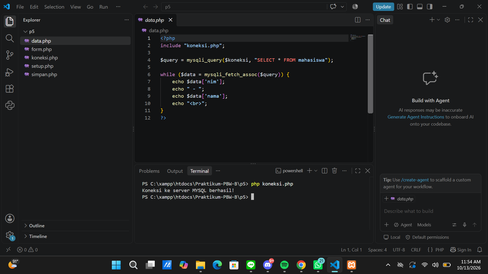
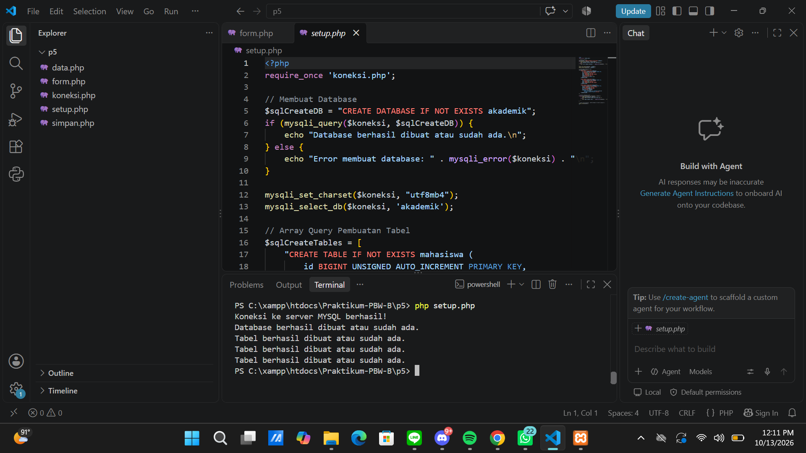
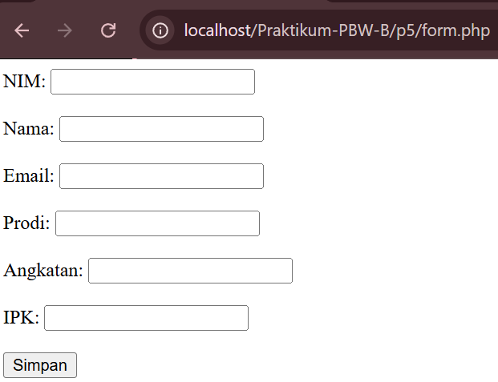
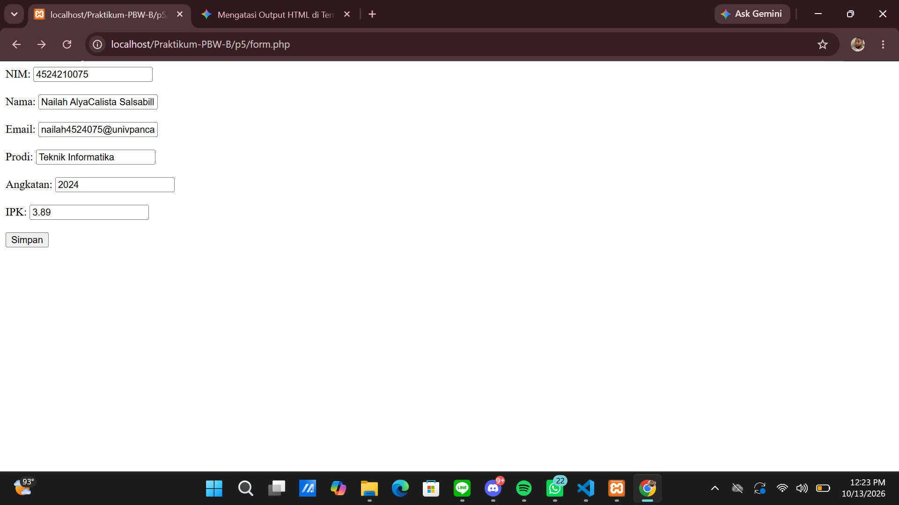
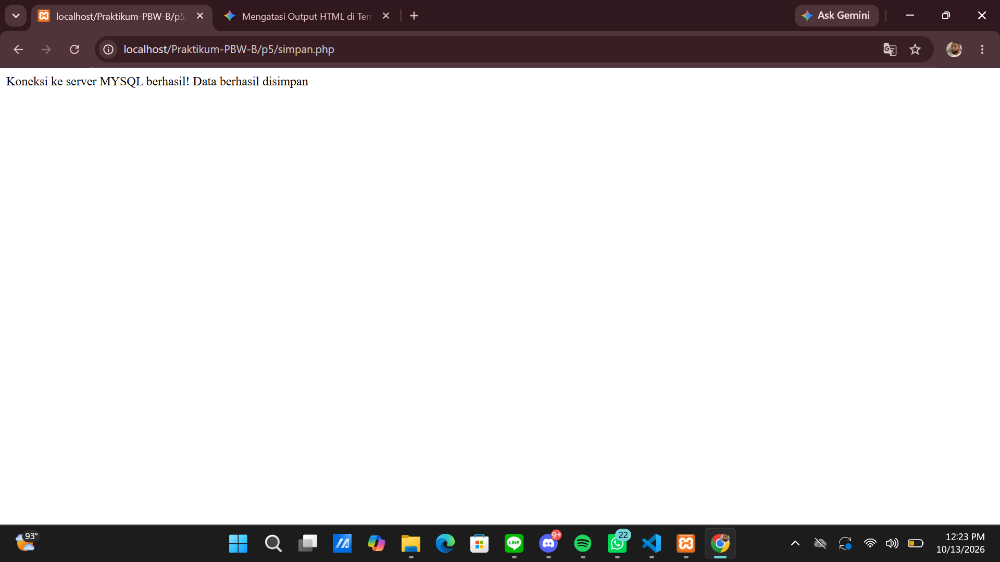
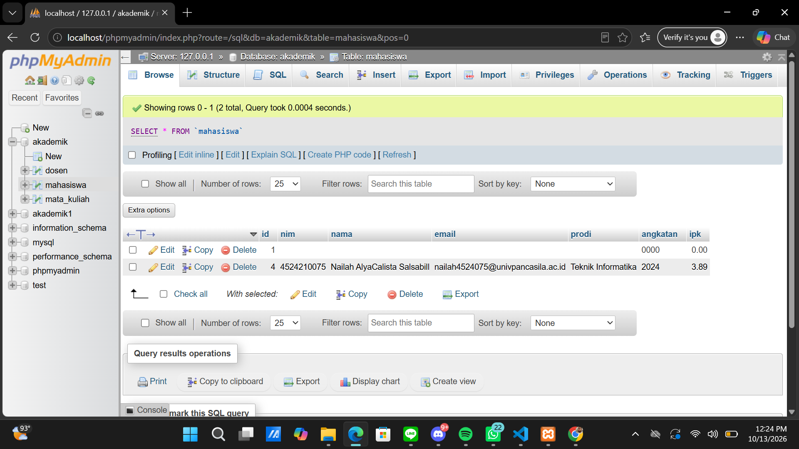
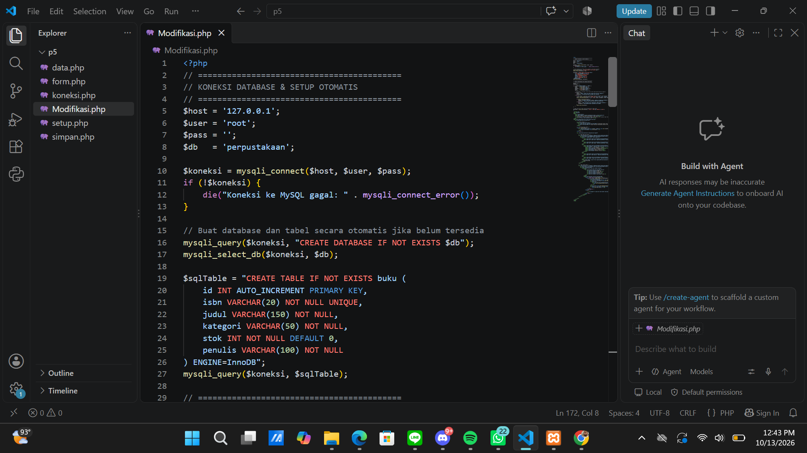
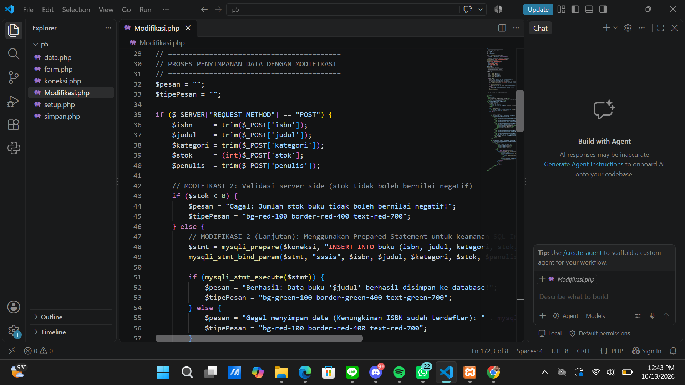
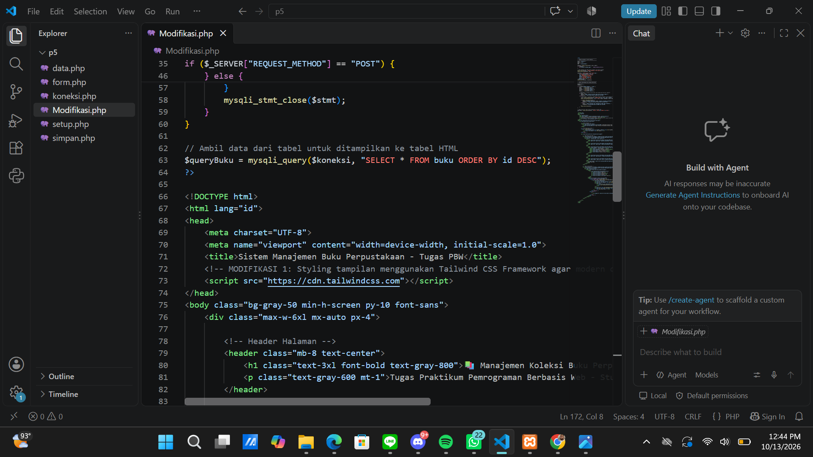

# Laporan Praktikum Pemrograman Berbasis Web
**Materi:** Modifikasi Kode & Interaksi PHP-MySQL  
**Studi Kasus:** Sistem Data Mahasiswa (Awal) ➔ Sistem Manajemen Buku Perpustakaan (Modifikasi)

---

## 1. Perbandingan Sebelum dan Sesudah Modifikasi

Berikut adalah perbandingan komparatif dari program sebelum dan sesudah dilakukan modifikasi:

| Fitur / Komponen | Sebelum Modifikasi (Base Code) | Sesudah Modifikasi (Updated Code) |
| :--- | :--- | :--- |
| **Studi Kasus** | Pengelolaan Data Mahasiswa (NIM, Nama, Email, Prodi, Angkatan, IPK) | Pengelolaan Koleksi Buku Perpustakaan (ISBN, Judul, Kategori, Penulis, Stok) |
| **Antarmuka (UI)** | HTML Polos tanpa styling CSS | UI Modern Responsif menggunakan **Tailwind CSS** |
| **Metode Eksekusi Query** | Direct Query (`mysqli_query` langsung) | **Prepared Statements** (`mysqli_prepare` & `mysqli_stmt_bind_param`) |
| **Validasi Input** | Hanya atribut `required` bawaan HTML | Validasi Server-Side (Pengecekan stok buku tidak boleh negatif) |
| **Penyajian Data** | Terpisah (File `form.php` dan `data.php`) | Terintegrasi dalam 1 Halaman (`Modifikasi.php`) |

---

## 2. Bukti Tangkapan Layar (Screenshot)

### A. SEBELUM DIMODIFIKASI (KODE AWAL)

#### 1. Uji Koneksi Database via Terminal
  
*(Gambar 1.1: Pengujian koneksi database melalui command line terminal)*

#### 2. Setup Database & Tabel Otomatis
  
*(Gambar 1.2: Proses pembuatan database dan tabel menggunakan skrip setup.php)*

#### 3. Tampilan Form Input Awal di Browser
  
*(Gambar 1.3: Tampilan form input HTML polos pada browser)*

#### 4. Pengisian Data pada Form Input
  
*(Gambar 1.4: Contoh pengisian data input mahasiswa)*

#### 5. Output Pesan Berhasil Disimpan
  
*(Gambar 1.5: Notifikasi teks berhasil disimpan setelah submit form)*

#### 6. Pengecekan Data pada phpMyAdmin
  
*(Gambar 1.6: Bukti data masuk ke dalam tabel database MySQL)*

---

### B. SESUDAH DIMODIFIKASI (KODE BARU)

#### 7. Kode Program Modifikasi: Koneksi & Setup Tabel Buku
  
*(Gambar 2.1: Implementasi struktur tabel buku baru pada skrip modifikasi)*

#### 8. Kode Program Modifikasi: Validasi & Prepared Statement
  
*(Gambar 2.2: Implementasi keamanan Prepared Statement dan validasi stok tidak boleh negatif)*

#### 9. Kode Program Modifikasi: Integrasi Tailwind CSS UI
  
*(Gambar 2.3: Perancangan antarmuka menggunakan kerangka Tailwind CSS)*

---

## 3. Penjelasan 5 Bagian Kode Paling Penting

1. **`$koneksi = mysqli_connect($host, $user, $pass);`**  
   Menghubungkan aplikasi PHP dengan server database MySQL secara dinamis.
2. **`if ($_SERVER["REQUEST_METHOD"] == "POST")`**  
   Memastikan logika penyimpanan hanya diproses saat form dikirim melalui metode HTTP POST.
3. **`$stmt = mysqli_prepare($koneksi, "INSERT INTO buku ... VALUES (?, ?, ?, ?, ?)");`**  
   Membuat templat query aman (*Prepared Statement*) untuk mencegah celah keamanan *SQL Injection*.
4. **`mysqli_stmt_bind_param($stmt, "sssis", ...);`**  
   Mengikat tipe data dan nilai variabel ke parameter query secara presisi sebelum dieksekusi.
5. **`if ($stok < 0)`**  
   Logika validasi *server-side* untuk mengecek keabsahan input angka agar stok buku tidak bernilai negatif.

---

## 4. Penanganan Error yang Pernah Terjadi

* **Error:** `PHP Warning: Undefined array key "REQUEST_METHOD" ...`
* **Penyebab:** Membuka skrip PHP langsung melalui Terminal CLI (`php simpan.php`) alih-alih melalui Web Server Apache.
* **Solusi:** Menyalakan layanan Apache di XAMPP dan mengakses file melalui browser dengan URL `http://localhost/...`.
